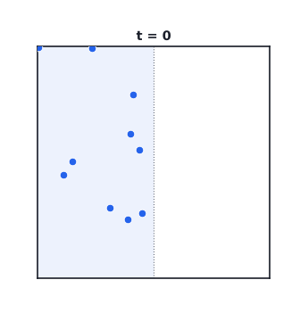
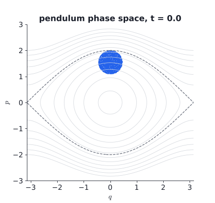
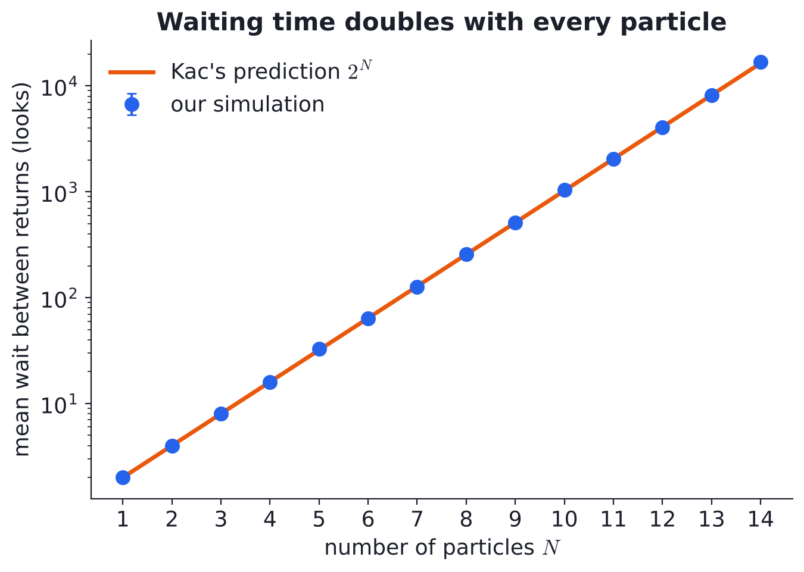

# Everything Comes Back (Eventually)

**The Poincaré Recurrence Theorem**, a classical mechanics course project at IIT Bombay.

Wait long enough and almost every state of a closed, frictionless system returns as close as we like to where it started. This repo has the simulations, the figures, the slides and the study notes.

<p align="center">
  
  
  
</p>

## What is inside

| Folder | What |
|---|---|
| `src/` | One Python script per idea. Each one makes its own figures |
| `figures/` | All plots (PNG), animations (GIF) and the raw numbers (`05_results.csv`) |
| `slides/` | `slides.pptx` (PowerPoint, editable), `slides.md` (Marp source) and `slides.pdf` |
| `report/` | `report.pdf` (the course report to submit) and `report.tex` (its LaTeX source) |
| `notes/physics_notes.md` | Proofs, derivations, numbers and likely questions |
| `notebook/` | Colab notebook that runs everything in the browser |

## The storyline (8 slides, 8 minutes)

| # | Slide | Speaker | Figure |
|---|---|---|---|
| 1 | Hook: will the air in this room gather in one corner? | 1 | cat map strip |
| 2 | The theorem in plain words | 1 | none |
| 3 | Proof: the pigeonhole idea | 2 | `01_pigeonhole_proof.png` |
| 4 | Liouville: why Hamiltonian systems qualify, and why friction kills it | 2 | `02_liouville_slide.png` |
| 5 | Example 1: two oscillators on a torus | 3 | `03_torus.png` |
| 6 | Example 2: chaos does not stop it (cat map) | 3 | `04_cat_map_strip.png` |
| 7 | **Our numerical case:** a gas in a box | 4 | `05_gas_snapshots.png`, `05_left_fraction.png` |
| 8 | How long is "eventually"? Kac's lemma and the second law | 4 | `05_kac_scaling.png` |

Speaker notes (what to say on each slide) are inside `slides/slides.md` as comments. Swap the speaker numbers to fit the group.

## Run the code

**In the browser (no install):** open `notebook/poincare_recurrence.ipynb` in Google Colab and press *Run all*.

**On a laptop:**

```bash
pip install -r requirements.txt
python src/make_all.py          # rebuilds every figure, about 2 to 3 minutes
python src/05_gas_in_box.py     # or just one script
```

| Script | What it shows | Key check |
|---|---|---|
| `01_proof_pigeonhole.py` | Copies of a disk under an area-keeping map must overlap | copy 17 hits the original |
| `02_liouville_blob.py` | Pendulum blob keeps its area. With friction it shrinks | area 0.63617 to 0.63616, damped matches $e^{-\gamma t}$ |
| `03_torus_oscillators.py` | Two oscillators, ratio $\varphi$, return near the start | mean return time matches $(2\pi)^n/(\lvert\omega\rvert\sigma_\varepsilon)$ within 3% |
| `04_cat_map.py` | Chaotic pixel shuffle returns exactly | period 25 on a $101 \times 101$ grid |
| `05_gas_in_box.py` | **Main numerical case.** $N$ particles, all start on the left | mean return time $= 2^N$ (Kac) for $N = 1$ to 14 |
| `06_gas_torus.py` | The gas drawn as a point on a torus: bounce = circle, 2 particles = square with glued edges, target = a quarter | mean wait 4.000 looks for $N = 2$ (Kac: 4) |

## Edit the slides

The slides are plain Markdown using [Marp](https://marp.app). Every slide is a block of text separated by `---`.

1. Install **VS Code** and the extension **Marp for VS Code**
2. Open `slides/slides.md` and click the preview icon (top right). It updates live as you type
3. Export: command palette (`Ctrl+Shift+P`), *Marp: Export slide deck*, choose PDF

Or from a terminal: `npx @marp-team/marp-cli slides/slides.md --pdf --allow-local-files`

Math is written in LaTeX between `$ ... $`. Images are ``.

## Results at a glance



The waiting time for all $N$ particles to be back on the left doubles with every particle. For $N = 100$, looking once per millisecond, the wait is about $4 \times 10^{19}$ years. That is roughly 3 billion times the age of the universe, which is why nobody has seen the air in a room un-mix itself.
