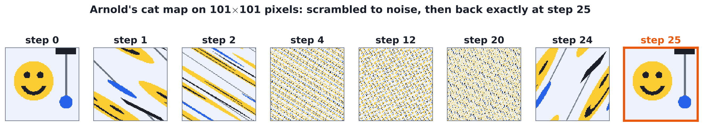
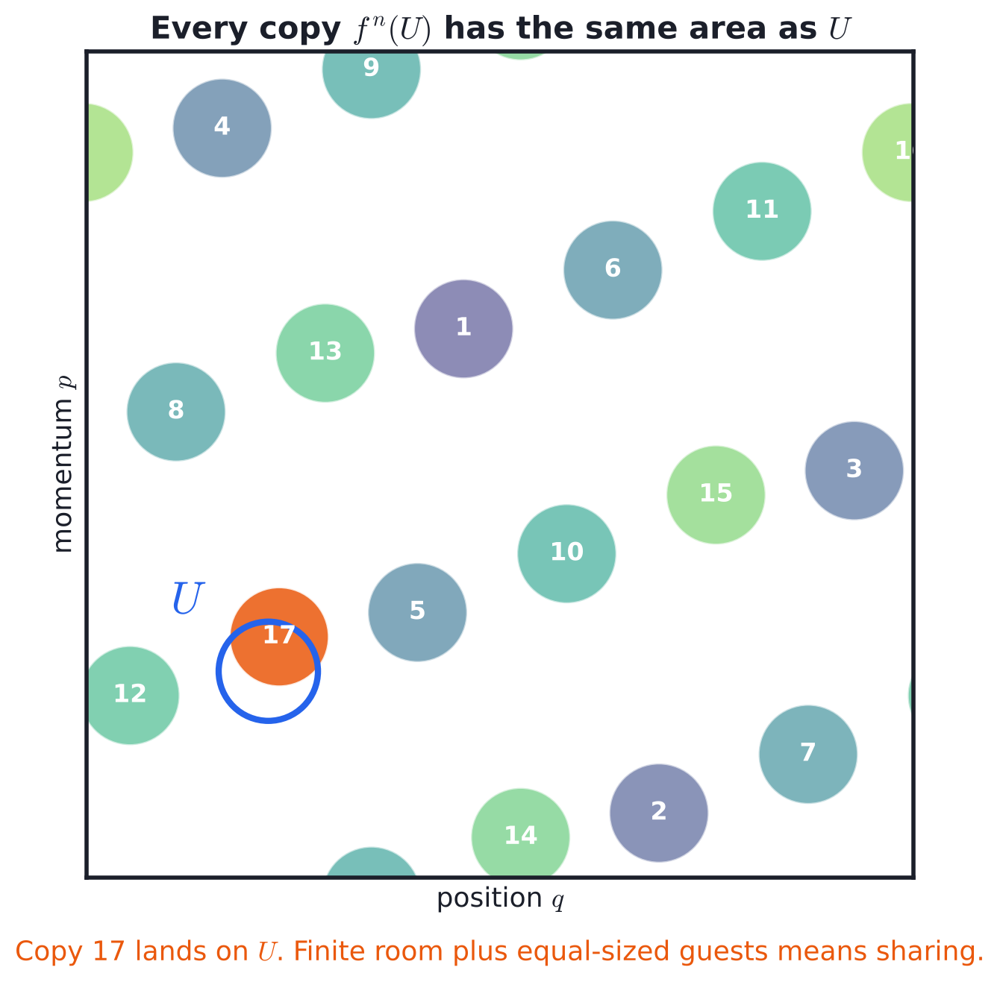
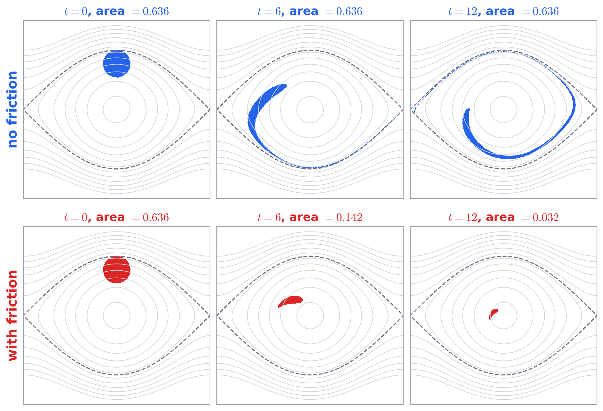
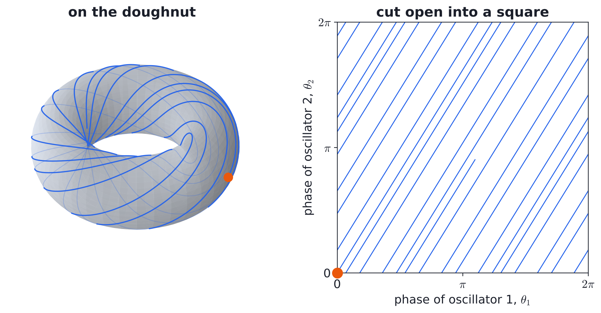
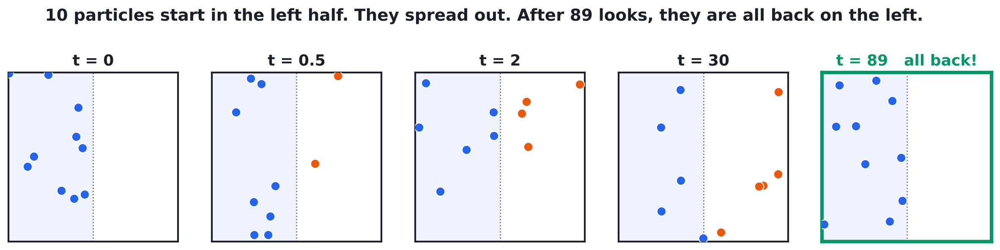
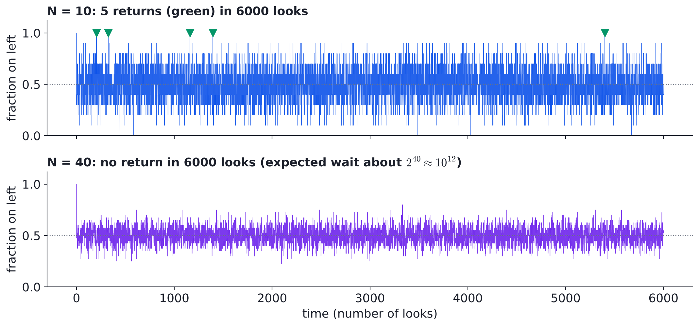
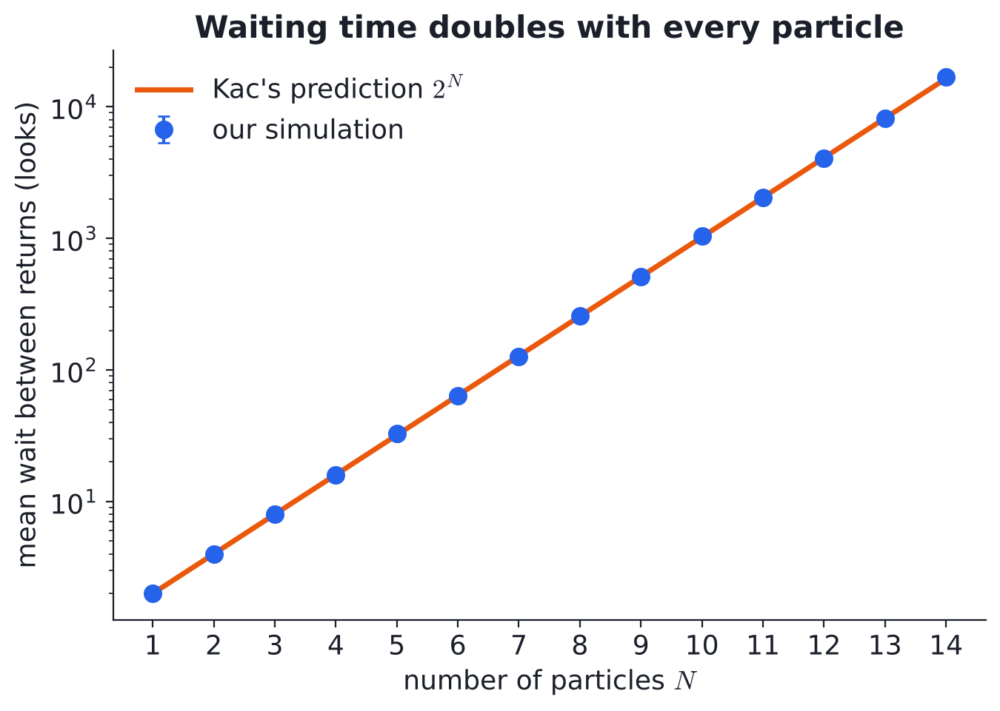
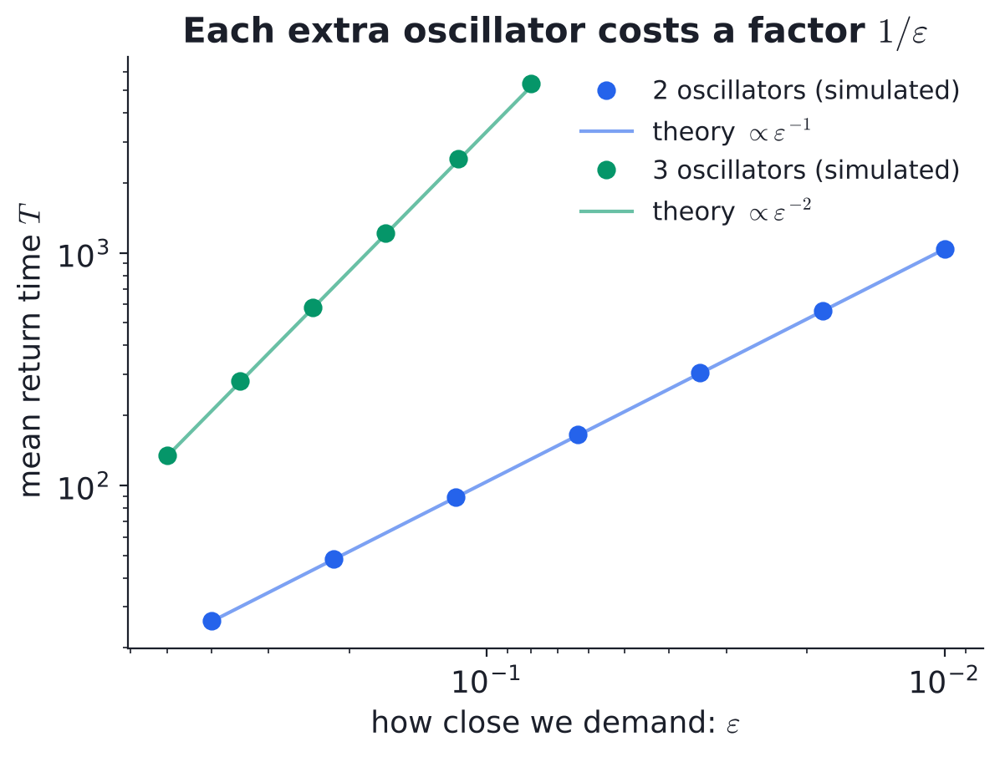
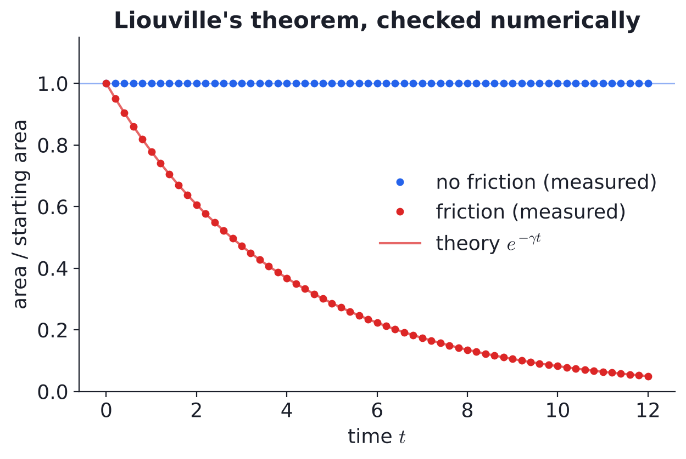

<!-- _class: title -->
<!-- _paginate: false -->

# Everything Comes Back (Eventually)

The Poincaré Recurrence Theorem

 

[Name 1] · [Name 2] · [Name 3] · [Name 4] &nbsp;&nbsp;|&nbsp;&nbsp; Classical Mechanics course project, IIT Bombay

<!--
SPEAKER 1 (about 30 s)
Hook: "If we let the air in this room move around for long enough, will it all gather in one corner?"
Physics says yes. Our job today is to show why, and then to explain why nobody has fainted from it yet.
The picture: a smiley face gets scrambled into noise and then comes back perfectly. Keep that in mind, we come back to it.
-->

---

## The theorem

Let $T$ map a space $\Omega$ to itself, with **finite volume** $\mu(\Omega) < \infty$ and **no squeezing**: $\mu(T^{-1}A) = \mu(A)$ for every set $A$.

Then for any set $A$ with $\mu(A) > 0$, **almost every** point of $A$ comes back to $A$, and does so **infinitely often**.

 

**In plain words:** wait long enough and almost every state returns as close as we like to where it started.

- *Finite room*: the system cannot run off to infinity
- *No squeezing*: volume of a set of states stays fixed
- *Almost every*: the exceptions have zero volume

Poincaré found this in 1890 while working on the three-body problem.

<!--
SPEAKER 1 (about 60 s)
Read the statement slowly. Then translate each condition.
Finite room: bounded phase space, like a gas in a closed box with fixed energy.
No squeezing: the map keeps volumes the same. We show on slide 4 that Hamiltonian motion does exactly this.
Almost every: some special points may never come back, but you could never pick one at random.
-->

---

## Proof in one picture: the pigeonhole idea

Let $B \subset A$ be the points that **never** return to $A$.

- The sets $B,\ T^{-1}B,\ T^{-2}B, \dots$ never overlap. If two did, a point of $B$ would come back to $B$.
- Each has the same volume $\mu(B)$.
- They all fit inside $\Omega$, so
$$\sum_{k=0}^{\infty} \mu(B) \;\le\; \mu(\Omega) < \infty \;\Rightarrow\; \mu(B) = 0.$$

Infinitely often: the points that return only finitely many times also form a zero-volume set, by the same trick.

<!--
SPEAKER 2 (about 70 s)
Point at the picture first. A disk U, and its copies after 1, 2, 3 ... steps of an area-preserving map.
Each copy is just as big. The box is finite. So copies run out of free space and one has to land on U. Here it is copy 17.
Then the three bullet points are the same idea written properly: infinitely many disjoint sets of equal positive volume cannot fit in a finite box.
-->

---

## Why physics cares: Liouville's theorem

Hamilton's equations: $\dot q = \partial H/\partial p$, $\ \dot p = -\partial H/\partial q$

The flow in phase space has zero divergence:
$$\frac{\partial \dot q}{\partial q} + \frac{\partial \dot p}{\partial p} = \frac{\partial^2 H}{\partial q\,\partial p} - \frac{\partial^2 H}{\partial p\,\partial q} = 0$$

So **volume is kept**. Fixed energy in a box keeps the **room finite**. Both conditions hold.

Add friction $-\gamma p$: divergence becomes $-\gamma$, area shrinks like $e^{-\gamma t}$. No recurrence.

A blob of pendulums. Area without friction: 0.63617 at the start, 0.63616 at the end.

<!--
SPEAKER 2 (about 60 s)
The top row: thousands of pendulums starting in a small disk. The blob swirls into a thin banana but its area stays at 0.636.
The bottom row: same thing with friction. The blob shrinks to a dot at the bottom. That pendulum is never swinging high again.
So Poincare recurrence is really a statement about Hamiltonian, frictionless systems.
-->

---

## Example 1: two oscillators with an irrational ratio

- Phases $\theta_1 = \omega_1 t$, $\theta_2 = \omega_2 t$, ratio $\omega_2/\omega_1 = \varphi = 1.618\ldots$
- The state lives on a **torus**. The path **never closes**, yet comes back as close as we like

- Mean wait to return within $\varepsilon$: $T \propto \varepsilon^{-1}$ for 2 oscillators, $\varepsilon^{-2}$ for 3
- Simulation matches $T = (2\pi)^n / (|\omega|\,\sigma_\varepsilon)$ to within 3%

<!--
SPEAKER 3 (about 60 s)
Two springs that do not share a common period. The pair of phases moves on a doughnut.
Because the ratio is irrational the path never repeats exactly, it just keeps winding.
But it keeps coming back close to the orange start point.
Key lesson for later: each extra oscillator multiplies the waiting time by about 1/epsilon. More parts means much longer waits.
(Backup slide has the log-log plot if someone asks.)
-->

---

## Example 2: chaos does not stop it (Arnold's cat map)

$$\begin{pmatrix} x \\ y \end{pmatrix} \mapsto \begin{pmatrix} 2 & 1 \\ 1 & 1 \end{pmatrix} \begin{pmatrix} x \\ y \end{pmatrix} \bmod N, \qquad \det = 1 \ \Rightarrow\ \text{no squeezing}$$

- Very chaotic: lengths stretch by $\tfrac{3+\sqrt5}{2} \approx 2.6$ every step
- Still, a shuffle of a **finite** set of pixels must repeat

- On a $101 \times 101$ grid the face returns **exactly** at step 25
- Cats always come home. This one just takes the scenic route

<!--
SPEAKER 3 (about 60 s)
This is the scary-looking example. The map stretches and folds the picture, which is what chaos means.
By step 4 it looks like TV static. Most people would bet it is gone forever.
But the map only shuffles a finite number of pixels, and it never sends two pixels to the same place.
A shuffle repeated enough times has to repeat itself. Step 25: the face is back, pixel perfect.
-->

---

## Our numerical case: a gas in a box

- $N$ free particles bounce off the walls. All start on the **left**
- Unfold each bounce: the gas becomes a point on an $N$-torus. Finite, no squeezing, so **they must come back**
- $N=10$: back 5 times in 6000 looks. $N=40$: not once

<!--
SPEAKER 4 (about 60 s)
This is the case we solved numerically ourselves (src/05_gas_in_box.py).
Ten particles start in the left half. They spread out like any gas. After 89 looks, all ten are on the left again.
Bottom plot: the fraction on the left. For 10 particles it hits 1 now and then (green). For 40 particles it never does in our run.
So how long should we wait? Next slide.
-->

---

## How long is "eventually"?

"All on the left" takes up $\mu(A) = 2^{-N}$ of the torus. **Kac's lemma**:
$$\langle T \rangle = \frac{1}{\mu(A)} = 2^N \text{ looks}$$

Our runs (about 4000 returns each) agree for $N = 1$ to $14$.

$N = 100$, one look per millisecond: $\sim 4 \times 10^{19}$ years, about **3 billion times the age of the universe**. A room has $\sim 10^{27}$ molecules.

Recurrence is guaranteed, but for big systems it is slower than slow. That is how it lives in peace with the second law.

<!--
SPEAKER 4 (about 70 s)
Kac's lemma turns Poincare's "eventually" into a number: one over the size of the target region.
Blue dots are our simulation, orange line is 2 to the N. They sit on top of each other.
Then the punchline: 100 particles already need billions of universe lifetimes. Air in a room has about 10^27.
So entropy increase and recurrence do not fight. Recurrence wins in principle, the second law wins in practice.
Thank you. Happy to take questions.
-->

---

<!-- _paginate: false -->

## Backup: return time vs closeness

Left: mean return time to an $\varepsilon$-ball for 2 and 3 oscillators, with the flux formula. Right: blob area with and without friction against $e^{-\gamma t}$.

**References:** H. Poincaré, *Acta Math.* 13 (1890) · M. Kac, *Bull. AMS* 53 (1947) · V. I. Arnold & A. Avez, *Ergodic Problems of Classical Mechanics* (1968) · F. J. Dyson & H. Falk, *Amer. Math. Monthly* 99 (1992)

